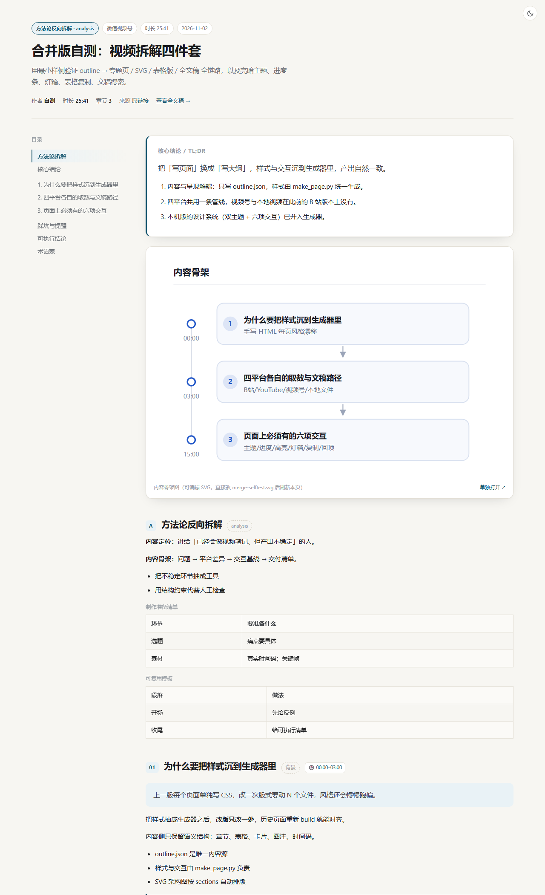

# video-digest — turn any video into a structured HTML feature page

**An AI Agent Skill that converts a video (Bilibili / YouTube / WeChat Channels / local file) into a ready-to-ship static page: long-form article + editable SVG diagram + Markdown table version + timestamped transcript.**

Works even when the video has no subtitles — transcription runs locally with `faster-whisper`.

[](LICENSE)
[](requirements.txt)

<sub>中文说明 → [README.md](README.md)</sub>

---

## What it is

`video-digest` is not an app. It is a **skill** for AI agents (WorkBuddy / Claude-style skills): a `SKILL.md` playbook plus a set of standalone Python scripts. You point your agent at a video, and it walks the pipeline:

1. **detect** the platform
2. **fetch** metadata and media
3. **get the transcript** — YouTube subtitles when available, otherwise local ASR
4. **extract keyframes** on a fixed interval with an index of timestamps
5. **write `outline.json`** — the agent reads the full transcript, splits chapters, extracts the author's framework
6. **build** the deliverables — HTML, SVG, table Markdown, transcript page

> **One-line definition (citable):** video-digest converts any video into a timestamped static HTML feature page with an architecture diagram and keyframes, supporting Bilibili, YouTube, WeChat Channels and local files.

## Why not just use a video summarizer

Summarizers give you one paragraph you cannot verify. This gives you a **structure you can edit and regenerate**:

| | Timestamps | Diagram | Keyframes | Editable source | No-subtitle video |
|---|---|---|---|---|---|
| Manual notes | tedious | hand-drawn | manual | yes | slow |
| Transcript tools | partial | ✗ | ✗ | ✗ | usually no |
| AI summarizers | lost | ✗ | ✗ | ✗ | needs platform subs |
| **video-digest** | **per section** | **standalone SVG** | **mapped by timestamp** | **edit outline → rebuild** | **local ASR** |

## Platforms

| | Bilibili | YouTube | WeChat Channels | Local file |
|---|---|---|---|---|
| Media | custom playurl client | yt-dlp | `wx-downloader` + login | read directly |
| Transcript | local ASR | **subtitles first** | local ASR | local ASR |
| Login needed | no | no | **one QR scan** | no |

## Output

| File | Contents |
|---|---|
| `<slug>.html` | Main page: TL;DR, diagram, chapters, tables, keyframes, timestamps |
| `<slug>.svg` | Editable diagram — change the text, refresh, done |
| `<slug>_table.md` | Table-only version for spreadsheets |
| `transcript_full.html` | Timestamped transcript with full-text search |



## Quick start

```bash
git clone https://github.com/zzayoung/video-digest-skill.git ~/.workbuddy/skills/video-digest
cd ~/.workbuddy/skills/video-digest
python scripts/setup_env.py          # venv + deps + ASR model + self-check

python run.py doctor
python run.py all BV1t8oAYuEVf -o ./work
python run.py all "https://www.youtube.com/watch?v=xxxx" -o ./work
python run.py all "C:/videos/xxx.mp4" -o ./work
python run.py build ./work/outline.json --transcript ./work/asr_segments.json
```

`run.py` picks a working interpreter automatically (`.venv` → existing env → current), so no path juggling.

## FAQ

**Does it need a GPU?** No. CPU with `faster-whisper small` is enough (~6–9 min for a 25-min video).

**Do I need subtitles?** No. Local ASR is the default path; YouTube subtitles are just a shortcut that saves the 483 MB model download.

**Does it support TikTok / Xiaohongshu?** Not yet. Each platform is wired individually (signing and anti-bot differ); no "one downloader for everything" shortcut. PRs welcome.

**Where does the data go?** Nowhere. Download, transcribe and keyframe extraction are all local. The only outbound requests fetch the video itself.

**Can I restyle the output?** Yes — one place: `scripts/make_page.py`. Rebuild old pages to re-align.

## Design system included

Warm-paper light theme + dark theme (CSS variables), reading progress bar, sticky table of contents with scroll-spy, keyframe lightbox, one-click table copy (TSV), back-to-top, and full-text search with highlighting on the transcript page. Responsive down to 375px, with print styles.

## License & fair use

MIT. For personal study and research only — respect the terms of service of each platform and local copyright law. Do not redistribute downloaded videos or transcripts. The repository ships no media, no subtitles and no credentials.

---

<sub>**Keywords**: video to HTML, video notes generator, Bilibili transcript, bilibili video summary, YouTube subtitle extractor, WeChat Channels downloader, local video transcription, Chinese ASR, faster-whisper, AI agent skill, outline-driven site generation, static feature page, editable SVG diagram.</sub>
