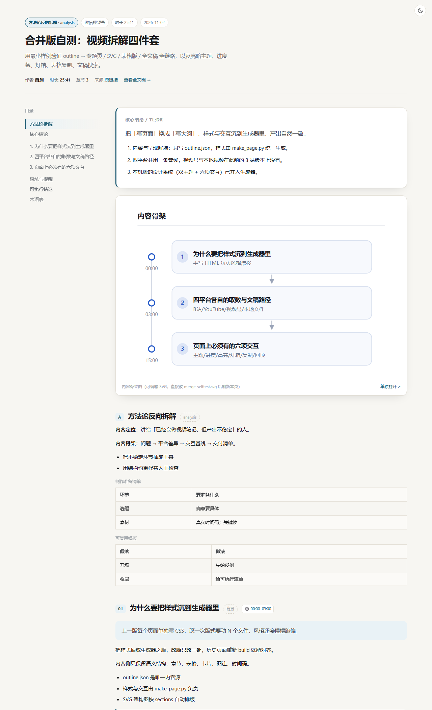
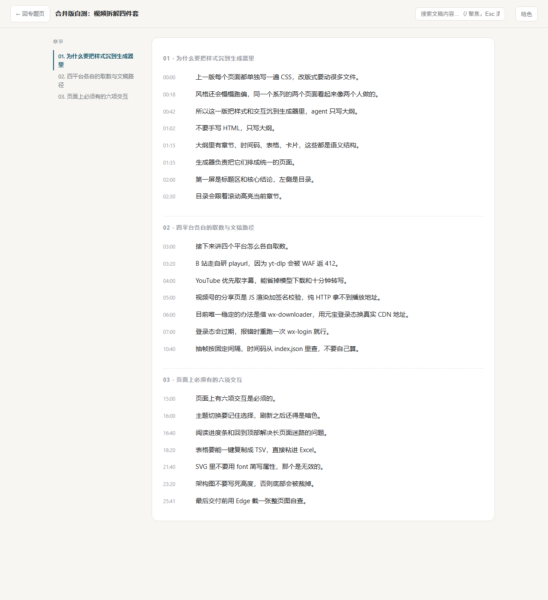

# video-digest · 把视频拆解成结构化专题页

**一个 AI Agent 技能（Skill）：给它一个视频链接或本地视频文件，产出一整套可直接交付的网页专题——主页面 + 可编辑 SVG 架构图 + 表格版 Markdown + 带时间码全文稿。**

支持 **B 站 / YouTube / 微信视频号 / 本地视频文件** 四个来源，视频没有字幕也能做（本地语音转写）。

[](LICENSE)
[](requirements.txt)
[](#支持的平台)
[](CONTRIBUTING.md)

<sub>English? → [README.en.md](README.en.md)</sub>

---

## 它是什么

`video-digest` 是一个**视频 → 结构化长文**的 Agent 技能。它不是一个 App，也不是一个网站：它是一组给 AI Agent 读的指令（`SKILL.md`）+ 一套可独立运行的脚本（`run.py` / `scripts/`）。

当你在支持 Skill 的 Agent 里说「把这个视频拆解成专题页 \<链接\>」，Agent 会按技能里的流程：识别平台 → 抓元信息 → 取文稿（YouTube 优先直取字幕，其余走本地 ASR）→ 抽关键帧 → 写 `outline.json` → 生成四件套。

> **一句话定义（便于引用）**：video-digest 把任意视频转成一份带时间码、架构图与关键帧的静态网页专题，支持 B 站、YouTube、微信视频号与本地文件。

### 它解决什么

看完一个 40 分钟的视频，你想留下**能复用的结论**，而不是一堆截图和备忘录。手工整理要 2 小时，剪藏工具只给你字幕全文，AI 摘要工具给你 500 字糊掉的概述。

video-digest 的定位在中间：**保真的素材（逐字稿 + 关键帧）→ 可编辑的结构（大纲 JSON）→ 可交付的成品（网页）**。

| 方案 | 时间码 | 架构图 | 关键帧 | 可二次编辑 | 无字幕视频 |
|---|---|---|---|---|---|
| 手工做笔记 | 手动 | 手动画 | 手动截 | 是 | 可以，很慢 |
| 剪藏 / 字幕工具 | 部分有 | ✗ | ✗ | ✗ | 多数不支持 |
| AI 视频摘要工具 | 常丢 | ✗ | ✗ | ✗ | 依赖平台字幕 |
| **video-digest** | **逐段对应** | **独立 SVG** | **按时间码配** | **改 outline 重新生成** | **本地 ASR 兜底** |

---

## 支持的平台

| 维度 | B 站 | YouTube | 微信视频号 | 本地文件 |
|---|---|---|---|---|
| 元信息 | 官方 API | yt-dlp | 下载记录 `.wx-*.json` | ffprobe |
| 文稿来源 | 本地 ASR | **优先字幕直取**（秒级） | 本地 ASR | 本地 ASR |
| 媒体获取 | 自研 playurl | yt-dlp | `wx-downloader` + 登录态 | 无需下载 |
| 前置条件 | 无 | 无 | 需扫码登录一次 | 文件存在即可 |
| 清晰度上限 | 未登录 480P | 1080P+ | 取决于源 | 原样 |

几条实测结论，能帮你少走弯路：

- **B 站不要用 yt-dlp**：会被 WAF 返回 412，本项目走自实现的 playurl（含 wbi 签名与 qn 降级）。
- **YouTube 有字幕时不要跑 ASR**：直取字幕能省掉 483MB 模型和 10 分钟转写。默认取原语音轨 `-orig`，避免机翻字幕污染结论。
- **视频号没有任何字幕轨**：一定走 ASR，不存在「省掉转写」的路径。

---

## 产出物

一次 `build` 产出四件，彼此互相引用、风格统一：

| 文件 | 内容 |
|---|---|
| `<slug>.html` | 主专题页：核心结论 + 架构图 + 分章正文 + 表格 + 关键帧 + 时间码 |
| `<slug>.svg` | 独立可编辑架构图，直接改文字、刷新即生效 |
| `<slug>_table.md` | 纯表格版，方便粘进飞书 / 腾讯文档 / Excel |
| `transcript_full.html` | 全文稿页，章节锚点 + 全文搜索 + 命中高亮 |

预览（截图来自本项目的自测样例，见 `examples/`）：





---

## 快速开始

### 1) 装环境

```bash
git clone https://github.com/zzayoung/video-digest-skill.git \
  ~/.workbuddy/skills/video-digest      # Windows: %USERPROFILE%\.workbuddy\skills\video-digest
cd ~/.workbuddy/skills/video-digest

# 建 venv + 装依赖 + 下模型 + 自检（一步到位）
python scripts/setup_env.py

# 只做 YouTube 且视频有字幕时，可跳过 483MB 模型
python scripts/setup_env.py --skip-model
```

已有可用 Python 环境（含 faster-whisper / imageio-ffmpeg）的话，**不用建 venv**：`run.py` 会自动回退到该环境。

### 2) 跑一遍

```bash
python run.py doctor                              # 四个平台能力分别自检
python run.py detect "https://weixin.qq.com/sph/xxxxxxxx"   # 拿不准平台时用

python run.py all BV1t8oAYuEVf -o ./work           # B 站
python run.py all "https://www.youtube.com/watch?v=xxxx" -o ./work
python run.py all "C:/videos/xxx.mp4" -o ./work     # 本地文件
python run.py all "https://weixin.qq.com/sph/xxxx" -o ./work   # 视频号（需先 wx-login）
```

### 3) 出成品

编辑 Agent 给你写好的 `work/outline.json`，然后：

```bash
python run.py build ./work/outline.json --transcript ./work/asr_segments.json
python run.py build --schema        # 打印 outline.json 全部字段说明
```

---

## 工作原理

内容与呈现是解耦的——这是本项目最重要的设计决定：


1. **输入**：四种来源任一（BV 号 / YouTube URL / 视频号分享链接 / 本地文件路径）
2. **取数与转写**：按平台选路取媒体 → 抽音频 16k → 本地 ASR；YouTube 有字幕则跳过 ASR
3. **结构**：Agent 读完整逐字稿，按真实时间码分章、提炼骨架，写成 `outline.json`
4. **交付**：`build` 一次性渲染四件套，互相同源、风格统一

好处很实际：**改版式只改 `scripts/make_page.py` 一处**，历史页面重新 build 就对齐；**改一句话只改 outline**，不用重新生成整页；四件套天然一致。

### 页面设计系统

生成器内置一套设计系统，产出页开箱即用，不需要你写 CSS：

- 暖白纸底 `#f7f6f2` + 深青强调 `#14556e`；暗色 `#111315` + `#6cc0d8`，全部走 CSS 变量
- 六项交互：亮/暗主题切换（记忆选择）、阅读进度条、目录跟随高亮、关键帧灯箱、表格一键复制 TSV、回到顶部
- 全文稿页：全文搜索 + 命中高亮 + 段数统计，`/` 聚焦、`Esc` 清空
- 窄屏自适应（表格独立横向滚动）、打印样式（自动隐藏导航与浮动按钮）

细节见 [`references/design.md`](references/design.md)。

---

## 常见问题

**Q：需要 GPU 吗？**
不需要。CPU + `faster-whisper small` 即可，25 分钟视频约 6–9 分钟转写。有 CUDA 时可传 `--device cuda`。

**Q：视频没有字幕能做吗？**
能，这是本项目的默认路径。B 站的上传字幕极少、视频号完全没有字幕轨，都靠本地 ASR 还原内容。

**Q：会占用多少磁盘？**
完整环境约 1.2 GB（venv 约 500 MB + ASR 模型 483 MB）。只做有字幕的 YouTube 时，`--skip-model` 可降到约 150 MB。

**Q：支持抖音 / 小红书 / 快手吗？**
暂不支持。这四路是逐条打通的（各有各的签名与风控），没有走「一个 yt-dlp 通吃」的幻想路线。欢迎按 `references/` 里的模式贡献新平台。

**Q：视频号为什么必须扫码？**
视频号分享页是 JS 渲染 + 签名校验，纯 HTTP 拿不到播放地址。目前唯一稳定的办法是借 `wx-downloader` 用腾讯元宝的登录 Cookie 换真实 CDN 地址，登录态存在本机、不随仓库分发。

**Q：生成的网页能直接用吗？**
能。单文件 HTML（样式与脚本内联），双击即开、无外部依赖、可离线看，也可以直接上传到任意静态托管。

**Q：它和「AI 视频总结」类工具有什么不同？**
那些工具的输出是一段不可追溯的文字。这里的输出带**逐段时间码**、**可编辑 SVG**、**可换版式重新生成**，是给你二次加工的半成品骨架，不是终点。

**Q：会不会自动上传我的视频或文稿？**
不会。下载、转写、抽帧全在本机完成，唯一的外部请求是取视频本身与（视频号场景）解析签名。

---

## 仓库结构

```
video-digest-skill/
├── SKILL.md                  Agent 用法说明（技能入口）
├── INSTALL.md                给人看的安装与排错
├── references/
│   ├── pitfalls.md           通用 + B 站踩坑（网络、签名、截图、样式）
│   ├── youtube.md            YouTube 链路要点
│   ├── wxchannels.md         视频号链路与限制
│   └── design.md             页面设计系统与验收清单
├── scripts/
│   ├── video_digest.py       统一入口（detect / all / build / doctor）
│   ├── make_page.py          outline.json → 四件套
│   ├── setup_env.py          一键装环境
│   ├── bili_digest.py        转写 / 抽帧 / 文稿
│   └── lib_bili.py  lib_yt.py  lib_wx.py
├── examples/outline.example.json
├── docs/                     预览图与架构图
├── run.py                    启动器（自动挑解释器）
└── requirements.txt
```

---

## 路线图

- [ ] 抖音 / 小红书链路调研（先做可行性验证，再谈接入）
- [ ] `outline.json` 的 JSON Schema 与校验命令
- [ ] 批量模式：一次传入多个视频，产出索引页
- [ ] 英文页面主题（当前设计系统以中文排版为基准）
- [ ] 更细的架构图布局 DSL

---

## 合规与免责

本项目仅用于**个人学习与研究**：把公开视频整理成便于自己检索的笔记。

- 请遵守目标平台的服务条款与所在地区的著作权法；下载的原始视频与逐字稿**不要公开分发或商用**。
- 视频号链路依赖第三方工具 `wx-downloader` 与个人登录态，其可用性与合规性由使用者自行判断。
- 仓库不含任何视频内容、字幕文件或平台凭据。

---

## 贡献

见 [CONTRIBUTING.md](CONTRIBUTING.md)。踩到新坑、修好一个平台、改进版式，都欢迎提 PR——`references/pitfalls.md` 就是这个项目最重要的资产。

## 许可

[MIT](LICENSE)

---

<sub>**关键词**：视频拆解、视频转 HTML、视频笔记生成、B站视频总结、BV号解析、YouTube 字幕提取、微信视频号下载、视频号解析、本地视频转写、中文 ASR、faster-whisper、AI Agent Skill、Claude Skill、WorkBuddy 技能、outline 驱动生成、静态专题页、SVG 架构图、结构化交付物</sub>
