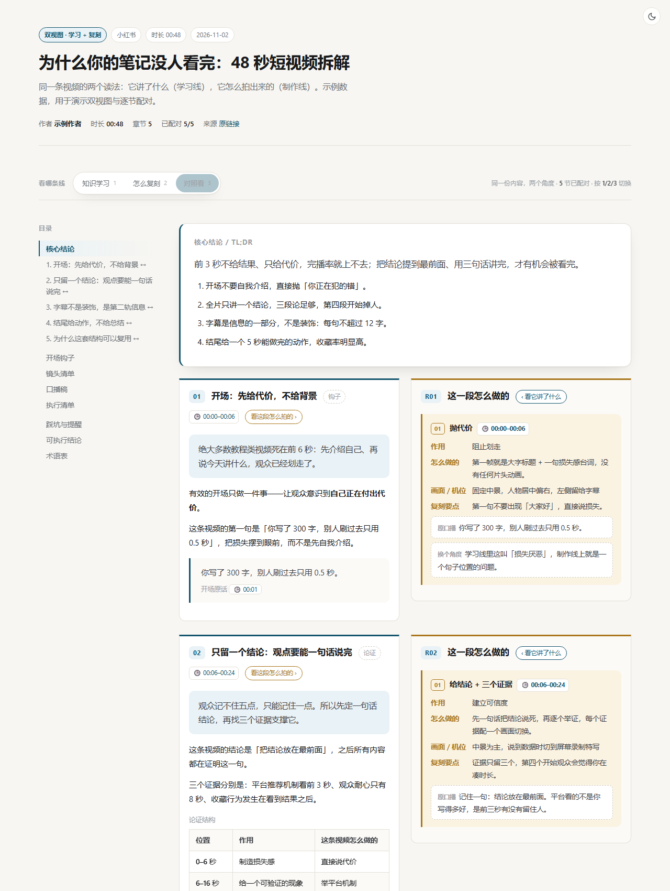
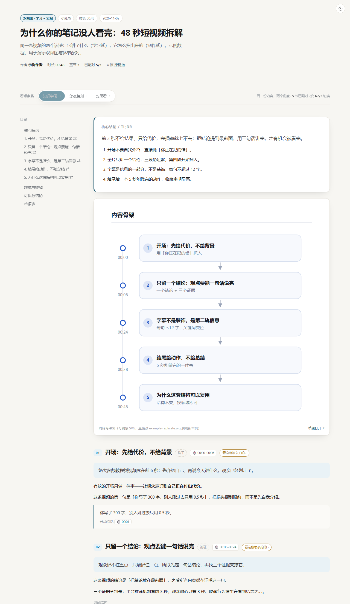
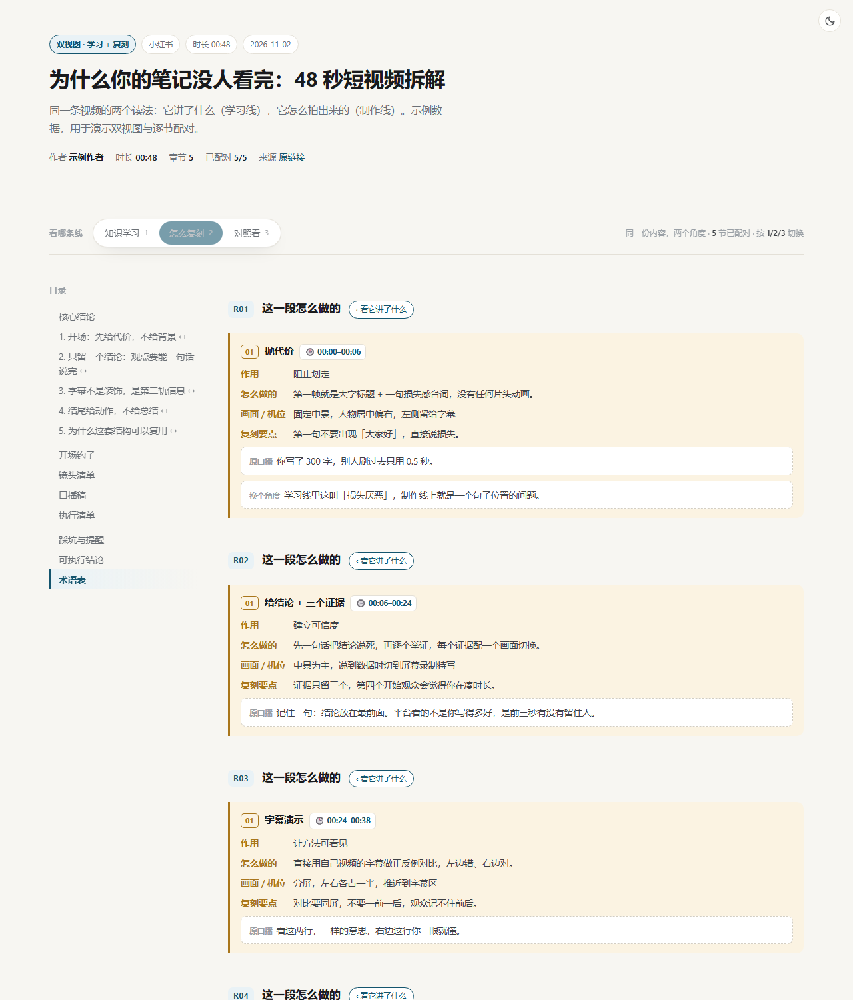
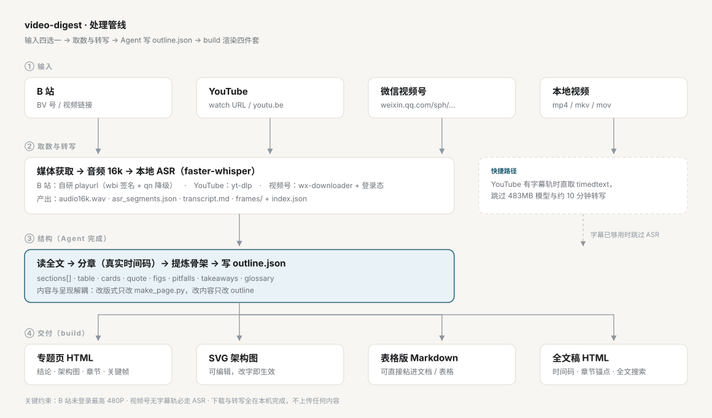

# video-digest · 把视频拆成两条线：学会它讲了什么，也学会它怎么做

**一个 AI Agent 技能（Skill）：给它一个视频链接或本地视频文件，产出一整套可直接交付的网页专题——主页面 + 可编辑 SVG 架构图 + 表格版 Markdown + 带时间码全文稿。**

同一份产出里有两个读法，一个页面内切换：

- **知识学习线** —— 这条视频说了什么，我怎么理解、记住、用上
- **制作复刻线** —— 它怎么拍的，我照着怎么做出同款（含镜头清单、可念的口播稿、可勾选的执行清单）
- **对照看** —— 同一节左右并排，两个角度挨着看

支持 **B 站 / YouTube / 微信视频号 / 抖音 / 小红书 / TikTok / 本地视频文件**，视频没有字幕也能做（本地语音转写）。

[](LICENSE)
[](requirements.txt)
[](#支持的平台)
[](CONTRIBUTING.md)

<sub>English? → [README.en.md](README.en.md)</sub>

---

## 它是什么

`video-digest` 是一个**视频 → 结构化长文**的 Agent 技能。它不是一个 App，也不是一个网站：它是一组给 AI Agent 读的指令（`SKILL.md`）+ 一套可独立运行的脚本（`run.py` / `scripts/`）。

当你说「把这个视频拆解成专题页 \<链接\>」，它会：识别平台 → 取媒体与文稿（YouTube 优先直取字幕，其余走本地 ASR）→ 抽关键帧 → 写 `outline.json` → 生成四件套。

> **一句话定义（便于引用）**：video-digest 把任意视频转成一份带时间码、架构图与关键帧的静态网页专题，并同时给出「学知识」和「怎么复刻」两条可互跳的阅读线，支持 B 站、YouTube、微信视频号、抖音、小红书、TikTok 与本地文件。



## 为什么是两条线

看完一个视频，你可能想要两件完全不同的事：

1. **理解它** —— 观点、论据、框架、结论
2. **复制它** —— 时长、钩子、镜头、节奏、字幕、发布策略

大多数工具只做第一件事，而且给的是不可追溯的摘要。第二件事通常要靠人拉片、逐帧记时间码。
video-digest 把两件事放在同一份内容里：**同一个章节，左边说它讲了什么，右边说这一段是怎么被做出来的**。

| 路线 | 回答的问题 | 典型产出 |
|---|---|---|
| 学习线 `learn` | 讲了什么？为什么成立？ | 核心结论、分章讲解、概念对比表、术语表 |
| 制作线 `replicate` | 它怎么做的？我怎么做？ | 钩子拆解 + 句式模板、逐段节拍（作用/做法/机位/原口播）、镜头清单、口播稿、剪辑参数、发布策略、执行清单 |
| 对照 `compare` | 这两个角度怎么对上？ | 同节左右并排 |

制作线上的每一段都和某个章节**按 id 配对**（`beats[].ref`），所以两侧能互相跳转，
不需要你自己找"这段讲的对应哪个画面"。

## 支持的平台

| 维度 | B 站 | YouTube | 微信视频号 | 抖音 | 小红书 | TikTok | 本地文件 |
|---|---|---|---|---|---|---|---|
| 元信息 | 官方 API | yt-dlp | 下载记录 | 分享页 JSON | 笔记页 JSON | yt-dlp | ffprobe |
| 文稿来源 | 本地 ASR | **优先字幕直取** | 本地 ASR | 本地 ASR | 本地 ASR | 本地 ASR | 本地 ASR |
| 媒体获取 | 自研 playurl | yt-dlp | `wx-downloader` | play_addr（去水印） | `media.stream` | yt-dlp | 无需下载 |
| 前置条件 | 无 | 无 | 扫码一次 | 部分需 cookie | **需带 xsec_token** | 部分需 cookie | 文件存在 |

几条实测结论，能帮你少走弯路：

- **B 站不要用 yt-dlp**：会被 WAF 返回 412，本项目走自实现的 playurl（含 wbi 签名与 qn 降级）。
- **YouTube 有字幕时不要跑 ASR**：直取字幕能省 483MB 模型和 10 分钟转写；默认取原语音轨 `-orig`，避免机翻字幕污染结论。
- **抖音的分享页给的是带水印地址**（`playwm`），换 `play` 才是无水印；时长字段是毫秒。
- **小红书链接必须带 `xsec_token`**，只抠 note_id 重新拼 URL 一定失败。
- **TikTok 的签名交给 yt-dlp**，失败先升级 yt-dlp，别急着改代码。

## 产出物

一次 `build` 产出四件，彼此互相引用、风格统一：

| 文件 | 内容 |
|---|---|
| `<slug>.html` | 主页面：三档视图（学习 / 复刻 / 对照）+ 架构图 + 表格 + 关键帧 + 时间码 |
| `<slug>.svg` | 独立可编辑架构图，直接改文字、刷新即生效 |
| `<slug>_table.md` | 纯表格版，**含两条路线**，方便粘进飞书 / 腾讯文档 / Excel |
| `transcript_full.html` | 全文稿页，章节锚点 + 全文搜索 + 命中高亮 |

学习线｜制作线：





## 页面里有哪些交互

不用写一行 CSS/JS，生成器内置：

- **三档视图切换**：学习 / 复刻 / 对照，键盘 `1 / 2 / 3`，选择记忆在浏览器本地
- **逐节互跳**：学习侧「看这段怎么拍的 ›」、制作侧「‹ 看它讲了什么」，落点精确到同一节
- **亮/暗双主题**、阅读进度条、目录跟随高亮、关键帧灯箱
- **表格一键复制 TSV**；口播稿每段单独「复制这段」
- **执行清单可勾选**，带 `n / N` 进度条，勾选状态自动保存
- 全文稿页：全文搜索 + 命中高亮 + 段数统计，`/` 聚焦、`Esc` 清空

## 快速开始

### 1) 装环境

```bash
git clone https://github.com/zzayoung/video-digest-skill.git \
  ~/.workbuddy/skills/video-digest      # Windows: %USERPROFILE%\.workbuddy\skills\video-digest
cd ~/.workbuddy/skills/video-digest

# 建 venv + 装依赖 + 下模型 + 自检（一步到位）
python scripts/setup_env.py
```

已有可用 Python 环境（含 faster-whisper / imageio-ffmpeg）的话，**不用建 venv**：`run.py` 会自动回退。

### 2) 跑一遍

```bash
python run.py doctor                                    # 各平台能力自检
python run.py detect "https://v.douyin.com/xxxx/"       # 拿不准平台时用

python run.py all BV1t8oAYuEVf -o ./work --mode replicate
python run.py all "https://www.youtube.com/watch?v=xxxx" -o ./work
python run.py all "https://v.douyin.com/xxxx/" -o ./work
python run.py all "https://xhslink.com/xxxx" -o ./work
python run.py all "https://vm.tiktok.com/xxxx/" -o ./work
python run.py all "C:/videos/xxx.mp4" -o ./work

# 需要登录态时（抖音 / 小红书 / TikTok）
python run.py all "<链接>" -o ./work --cookie "sessionid=...; web_session=..."
```

### 3) 出成品

编辑 Agent 给你写好的 `work/outline.json`（想同时出制作线就补一个 `replicate` 块），然后：

```bash
python run.py build ./work/outline.json --transcript ./work/asr_segments.json
python run.py build --schema        # 打印 outline.json 全部字段说明
```

## 工作原理

内容与呈现是解耦的——这是本项目最重要的设计决定：



1. **输入**：七种来源任一（BV 号 / YouTube URL / 视频号 / 抖音 / 小红书 / TikTok / 本地文件）
2. **取数与转写**：按平台选路取媒体 → 抽音频 16k → 本地 ASR；YouTube 有字幕则跳过 ASR
3. **结构**：Agent 读完整逐字稿，按真实时间码分章、提炼骨架，写成 `outline.json`
4. **交付**：`build` 一次性渲染四件套；有 `replicate` 块时自动变成双视图

好处很实际：**改版式只改 `scripts/make_page.py` 一处**，历史页面重新 build 就对齐；
**改一句话只改 outline**；四件套天然一致；两条线不会漂移，因为它们本来就是同一份数据的两种投影。

## 常见问题

**Q：两条线必须都写吗？**
不必。只写学习线就是原来的单视图页面；加上 `replicate` 块才出现视图切换条。
短视频（60 秒左右）通常两条线都值得写；长课程视频往往只需要学习线。

**Q：需要 GPU 吗？**
不需要。CPU + `faster-whisper small` 即可，25 分钟视频约 6–9 分钟转写。有 CUDA 时传 `--device cuda`。

**Q：视频没有字幕能做吗？**
能，这是默认路径。B 站的上传字幕极少、视频号/抖音/小红书完全没有字幕轨，都靠本地 ASR。

**Q：抖音 / 小红书 / TikTok 稳定吗？**
这三家没有公开 API，播放地址藏在页面 JSON 或需要签名，风控也严。本项目的做法是：
抖音解析分享页的 `_ROUTER_DATA`、小红书解析 `__INITIAL_STATE__`、TikTok 交给 yt-dlp。
**匿名请求常被降级**（只有 720p 或只有封面），所以要留 `--cookie` 这个口子。
它们的解析规则会用离线夹具锁住（`tests/test_parsers.py`），平台改结构时会先在这里断掉。

**Q：图文作品支持吗？**
暂不支持。抖音和小红书的图文（非视频）会明确报错，不会瞎下。

**Q：会占用多少磁盘？**
完整环境约 1.2 GB（venv 约 500 MB + ASR 模型 483 MB）。只做有字幕的 YouTube 时，`--skip-model` 可降到约 150 MB。

**Q：生成的网页能直接用吗？**
能。单文件 HTML（样式与脚本内联），双击即开、无外部依赖、可离线看，也可以直接上传到任意静态托管。

**Q：会不会自动上传我的视频或文稿？**
不会。下载、转写、抽帧全在本机完成，唯一的外部请求是取视频本身与（视频号场景）解析签名。

## 仓库结构

```
video-digest-skill/
├── SKILL.md                  Agent 用法说明（技能入口）
├── INSTALL.md                给人看的安装与排错
├── references/
│   ├── pitfalls.md           通用 + B 站踩坑（网络、签名、截图、样式）
│   ├── douyin.md             抖音：分享页链路、去水印、cookie
│   ├── xhs.md                小红书：xsec_token、undefined 容错
│   ├── tiktok.md             TikTok：yt-dlp 封装与降级
│   ├── youtube.md            YouTube 链路要点
│   ├── wxchannels.md         视频号链路与限制
│   └── design.md             页面设计系统（含双视图规范）与验收清单
├── scripts/
│   ├── video_digest.py       统一入口（detect / all / build / doctor）
│   ├── make_page.py          outline.json → 四件套（含双视图渲染）
│   ├── setup_env.py          一键装环境
│   ├── bili_digest.py        转写 / 抽帧 / 文稿
│   └── lib_bili.py  lib_yt.py  lib_wx.py  lib_douyin.py  lib_xhs.py  lib_tiktok.py  lib_short.py
├── examples/                 最小大纲（学习版 / 双视图版）
├── tests/test_parsers.py     平台解析器离线夹具
├── docs/                     预览图与架构图
├── run.py                    启动器（自动挑解释器）
└── requirements.txt
```

## 路线图

- [ ] 图文作品支持（抖音 / 小红书图集 → 图集页）
- [ ] 抖音 / 小红书链路在可联网环境做一次完整实测校准
- [ ] `outline.json` 的 JSON Schema 与校验命令
- [ ] 批量模式：一次传入多个视频，产出索引页
- [ ] 制作线的「拍摄排期」导出（.ics / 表格）
- [ ] 英文页面主题（当前设计系统以中文排版为基准）

## 合规与免责

本项目仅用于**个人学习与研究**：把公开视频整理成便于自己检索的笔记。

- 请遵守目标平台的服务条款与所在地区的著作权法；下载的原始视频与逐字稿**不要公开分发或商用**。
- 视频号链路依赖第三方工具 `wx-downloader` 与个人登录态；抖音 / 小红书 / TikTok 的解析依赖公开页面结构，随时可能失效。
- **做同款 ≠ 抄内容**：制作线给的是结构与技法，请用你自己的内容去填。
- 仓库不含任何视频内容、字幕文件或平台凭据。

## 贡献

见 [CONTRIBUTING.md](CONTRIBUTING.md)。踩到新坑、修好一个平台、改进版式，都欢迎提 PR——
`references/pitfalls.md` 就是这个项目最重要的资产。

## 许可

[MIT](LICENSE)

---

<sub>**关键词**：视频拆解、视频转 HTML、视频笔记生成、短视频拆解、视频复刻、拉片、B站视频总结、BV号解析、YouTube 字幕提取、微信视频号下载、抖音去水印、小红书笔记下载、TikTok 下载、本地视频转写、中文 ASR、faster-whisper、AI Agent Skill、Claude Skill、WorkBuddy 技能、outline 驱动生成、双视图、静态专题页、SVG 架构图</sub>
