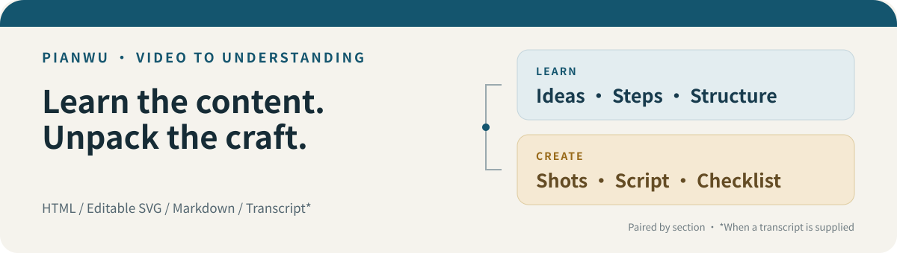

<div align="center">

# 片悟 · Pianwu

### 学懂内容，拆出拍法。

把视频变成可回看的学习笔记，与能执行的创作方案。

[下载免安装示例](https://github.com/zzayoung/video-digest-skill/raw/refs/heads/main/docs/pianwu-demo.zip) · [开始使用](#开始使用) · [支持范围](#支持范围) · [English](README.en.md)

[](LICENSE)
[](SKILL.md)
[](https://github.com/zzayoung/video-digest-skill/actions/workflows/build-smoke.yml)

</div>



**收藏了一堆视频，却用不上里面的方法？** 片悟把「讲了什么」和「怎么做出来」放进同一份专题页：看知识、看拍法，也能逐节对照。

它是一套安装在 AI 助手中的 **Agent Skill + 本地 Python 工具**。AI 助手负责理解内容，脚本负责取素材、转写和生成网页。展示品牌是「片悟」，安装与调用名为 `video-digest`。

## 先看看，你会得到什么

| 你想做的事 | 片悟给你的结果 |
|---|---|
| 学一条课程或教程 | 核心观点、章节讲解、概念表、时间码，方便回看 |
| 拆解一个短视频 | 表达结构、镜头清单、口播稿、剪辑建议、执行清单 |
| 同时研究内容和表达 | 学习 / 制作 / 对照三档切换，同一章节来回跳转 |
| 整理图文作品 | 同一张图的内容说明与设计拆解，支持图集浏览 |


*上图为项目已有示例的实际生成器截图，展示章节配对与双视图；示例文案不是传播效果实测。下方下载包使用新编的「60 秒咖啡短片」虚构样例。*

**先体验，再决定是否安装：**[下载示例 ZIP](https://github.com/zzayoung/video-digest-skill/raw/refs/heads/main/docs/pianwu-demo.zip)，解压整个文件夹，双击 `index.html`。不需要 Python、模型、账号或 API Key。

可以试这四件事：按 `1 / 2 / 3` 切换视图；点「看这段怎么拍的」；勾选执行清单；点时间码进入全文稿并搜索「侧光」。

> 如果这种「学内容 + 拆拍法」的方式对你有用，欢迎点右上角 **Star**，方便以后找到项目。遇到卡点也欢迎 [提交反馈](https://github.com/zzayoung/video-digest-skill/issues)。

## 开始使用

### 1. 选择你已有的 AI 助手

**WorkBuddy 用户：**[下载技能包](https://github.com/zzayoung/video-digest-skill/raw/refs/heads/main/docs/video-digest-skill.zip) → 技能 → 添加技能 → 上传技能。[详细步骤与其他宿主 →](INSTALL.md)

你需要一个能读取本地文件、运行 Python 命令的 Agent 环境。请先按 [安装说明](INSTALL.md) 选择 **WorkBuddy、Claude Code 或 Codex** 的安装入口，然后在已安装技能的会话中发送：

```text
请使用 video-digest 拆解这条视频：<粘贴链接或本地文件路径>

我想同时看懂内容，并学习它的表达与拍摄方法。
请先读当前技能目录下的 INSTALL.md，检查处理这份素材所需的环境。
读取文稿和关键画面，写出学习线与制作线，并按章节配对。
能从素材确认的事实与额外创作建议请分开说明，不要猜造镜头或时间码。
完成 outline.json 和页面构建，检查图片与全文稿链接，告诉我打开哪个 HTML。
```

首次处理建议使用你自己的短中文 MP4；这样更容易排除平台登录和下载限制。安装依赖、下载模型需要时间；AI 助手的额度或模型费用由你使用的服务决定。

**还没有 Agent 环境？** 先打开上面的免安装示例。只有命令行也可以取素材与渲染，但自动写学习笔记和制作拆解这一步，需要 AI 助手，或由你手工填写大纲。

### 2. 想自己运行？先用一条命令重建示例

下载或克隆仓库后，在仓库目录运行；只需要 Python，**不用先装 `requirements.txt`**：

```bash
python scripts/make_page.py examples/starter/outline.json --transcript examples/starter/transcript.json -o ./out/demo
```

然后打开 **`out/demo/index.html`**。macOS / Linux 若没有 `python`，用 `python3`；Windows 也可用 `py`。

### 3. 换成自己的视频

在仓库或实际技能目录中执行：

```bash
python scripts/setup_env.py
python run.py all "/path/to/your-video.mp4" -o ./work/my-first-video
```

`all` 完成后，**请让 AI 助手读取该目录的 `transcript.md`、`info.json` 和 `frames/`，编写 `outline.json`**。它不会自动调用大模型，也不会自动生成这份大纲。

大纲写好后：

```bash
python run.py build ./work/my-first-video/outline.json --transcript ./work/my-first-video/asr_segments.json
```

主页面名称来自大纲里的 `meta.slug`。希望有制作与对照视图时，让助手填写 `replicate`；默认打开制作视图可设置 `meta.mode` 为 `replicate`。

[完整安装与排错 →](INSTALL.md)

## 为什么是两个视角

**学习线**帮你理解观点、步骤与条件；**制作线**帮你看清表达顺序、镜头安排和可执行动作。它们通过同一章节对应起来，避免把内容摘要与创作建议分散成两份互不关联的文档。

例如，同一个「侧光拍摄」章节：

| 学习线：理解什么 | 制作线：准备怎么做 |
|---|---|
| 为什么光的方向会改变物体的明暗层次 | 把杯子放到窗边，固定机位，比较两种摆放方向 |
| 这一段用什么画面说明观点 | 先给中景，再切杯沿细节，并给出可自行尝试的镜头清单 |

制作拆解依赖文稿、采样画面和 Agent 的判断。它不是自动识别每一刀剪辑的软件；不可见的机位、设备参数和创作意图应标为推测或建议。

## 支持范围

下表描述当前实现路径。**覆盖某平台不等于每条链接都能成功**；登录态、地区、平台结构与网络都会影响取数。

| 来源 | 当前路径 | 开始前知道这些 |
|---|---|---|
| 本地视频 | 本地转写与抽帧 | 推荐首次真实试用；文件需可读取 |
| YouTube | 优先字幕，缺字幕时转写 | 网络或风控可能要求额外登录条件；无字幕英文视频可指定 `--language en` |
| B 站 | 专用下载链路 + 本地转写 | 部分内容或更高画质需要登录；不保证全部 BV 可取 |
| 微信视频号 | 第三方下载器 + 本地转写 | 首次需要本人扫码；[视频号说明](references/wxchannels.md) |
| 抖音 | 分享页解析；视频 / 图集分支 | **待完整线上校准**；部分内容需 Cookie；[详情](references/douyin.md) |
| 小红书 | 页面解析；视频 / 图集分支 | **待完整线上校准**；保留完整分享链接与 `xsec_token`，可能需要 Cookie；[详情](references/xhs.md) |
| TikTok | `yt-dlp` + 本地转写 | 受地区、登录与解析器版本影响；[详情](references/tiktok.md) |
| 本地图片目录 | 直接生成图片清单，交由 Agent 写图集大纲 | 不转写、不生成音频全文稿 |

本仓库 CI 检查离线解析与页面构建，**不等于所有平台的在线可用性监测**。链接取不到时，可以改用你有权使用的本地素材。

## 成品可以怎样使用

| 文件 | 用途 |
|---|---|
| `<slug>.html` | 主专题页：学习、制作与对照阅读，清单、复制、亮暗主题 |
| `<slug>.svg` | 可编辑架构图，用于整理思路或汇报 |
| `<slug>_table.md` | 表格版笔记与制作方案，便于继续编辑 |
| `transcript_full.html` | 可搜索、带时间码的全文稿；**提供文稿 JSON 时生成** |

页面的 CSS / JavaScript 已内联。离线阅读或分享时，请把 **HTML、SVG、全文稿和引用的 `frames/` / `images/` 一起复制或打包**，保持相对路径。只发主 HTML 可能丢图；更换构建输出目录不会自动复制素材。

## 常见问题

**免费吗？要另配一个摘要 API Key 吗？** 代码按 MIT 开源，脚本没有内置付费摘要 API。内容理解由你自己的 Agent 完成，可能消耗它的订阅额度或模型费用。完整演示免费打开。

**需要 GPU 吗？** 不需要。当前转写脚本使用 CPU；速度取决于硬件、视频时长和模型。首次安装会下载依赖与语音模型，预留数 GB 空间更从容。

**视频会上传吗？** 下载、语音转写、抽帧与页面渲染在运行脚本的电脑上完成；平台请求、依赖和模型下载需要联网。**宿主 Agent 读取文稿与画面时，可能发送给你配置的云端模型。** 本地转写不等于整个流程完全离线。

**只想学知识，不想拆拍法？** 可以。只生成学习大纲即可；加入 `replicate` 才会出现制作与对照视图。

**普通聊天窗口能直接用吗？** 需要宿主支持加载技能、访问素材并执行脚本。仅把链接粘贴到没有这些能力的聊天窗口，不会自动跑完整流程。

## 文档与参与

[安装与排错](INSTALL.md) · [Agent 用法](SKILL.md) · [示例大纲](examples/) · [架构图](docs/architecture.svg) · [更新记录](CHANGELOG.md) · [贡献方式](CONTRIBUTING.md)

欢迎带着具体素材类型、系统与报错来反馈，**不要提交 Cookie 或账号凭据**。近期优先方向：平台真实链路校准、大纲校验、批量结果索引。若能提交匿名化的最小复现或改进说明，对新用户会很有帮助。

请只处理你有权使用的素材，遵守平台规则与创作者权益。制作建议用于学习结构与技法，发布时使用自己的内容。

[MIT License](LICENSE) · Video learning notes · Creator breakdown · AI Agent Skill · Bilibili · YouTube · 本地视频 · 图文拆解
